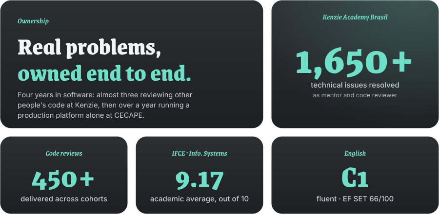
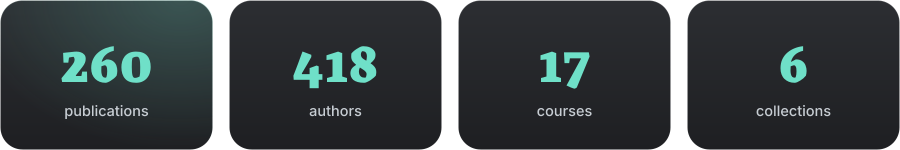
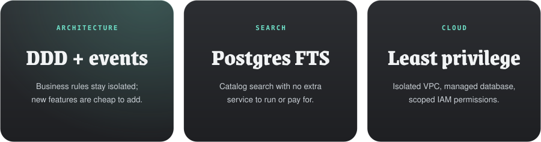
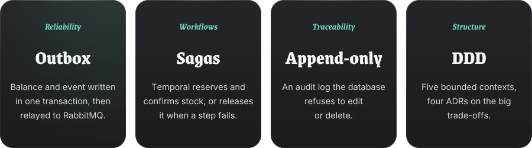
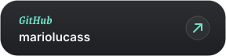

 

 

<picture>
  <source media="(prefers-color-scheme: dark)" srcset="./assets/sections/what-dark.svg">
  
</picture>

  

<picture>
  <source media="(prefers-color-scheme: dark)" srcset="./assets/sections/work-dark.svg">
  
</picture>

### CECAPE Tech · Academic Repository

**Sole technical owner · Architecture → Production on AWS**

The institutional repository of Faculdade CECAPE, designed and shipped from zero. **260 publications** from **418 authors**, across **17 courses**, organized in **6 collections**.

**[Visit the repository ↗](https://repositorio.faculdadececape.edu.br/)**

 

 

 

<b>Why no Elasticsearch?</b>

 

The catalog is a bounded, relational dataset. Postgres `tsvector` + GIN indexes cover ranking, stemming and filters in the same transaction as the rest of the data, so there is no second system to sync, secure, monitor or pay for. If the problem outgrows it, the domain boundary makes the swap local.

 

### Kenzie Academy Brasil

**Technical Mentor & Code Reviewer**

Unblocked developers at scale: **1,650+ technical issues resolved** and **450+ code reviews** delivered, raising code quality across cohorts.

 

<picture>
  <source media="(prefers-color-scheme: dark)" srcset="./assets/sections/building-dark.svg">
  
</picture>

 

### Iron Ledger · Inventory, audit and saga orchestration

*In development · TypeScript · Express · Prisma · PostgreSQL · RabbitMQ · Temporal · Next.js · Python*

A distributed system for stock operations: every mutation is traceable, multi-step transactions compensate when they fail, and the audit trail can't be rewritten.

**[Live demo ↗](https://iron-ledger-six.vercel.app/)**

 

 

Next.js frontend in Feature-Sliced Design, with a BFF that keeps the session JWT in an HTTP-only cookie. An isolated Python analytics service runs batch pipelines behind its own HTTP API.

 

<picture>
  <source media="(prefers-color-scheme: dark)" srcset="./assets/sections/toolkit-dark.svg">
  
</picture>

 

DDD &nbsp;·&nbsp; Event-driven &nbsp;·&nbsp; Sagas &nbsp;·&nbsp; REST &nbsp;·&nbsp; JWT &nbsp;·&nbsp; RBAC &nbsp;·&nbsp; Feature-Sliced Design

  

<picture>
  <source media="(prefers-color-scheme: dark)" srcset="./assets/sections/background-dark.svg">
  
</picture>

**B.Sc. Information Systems · IFCE** (expected 2027) Academic average **9.17/10** &nbsp;·&nbsp; English **C1**, EF SET 66/100

  

 

Open to engineering opportunities and conversations about my work.

 

